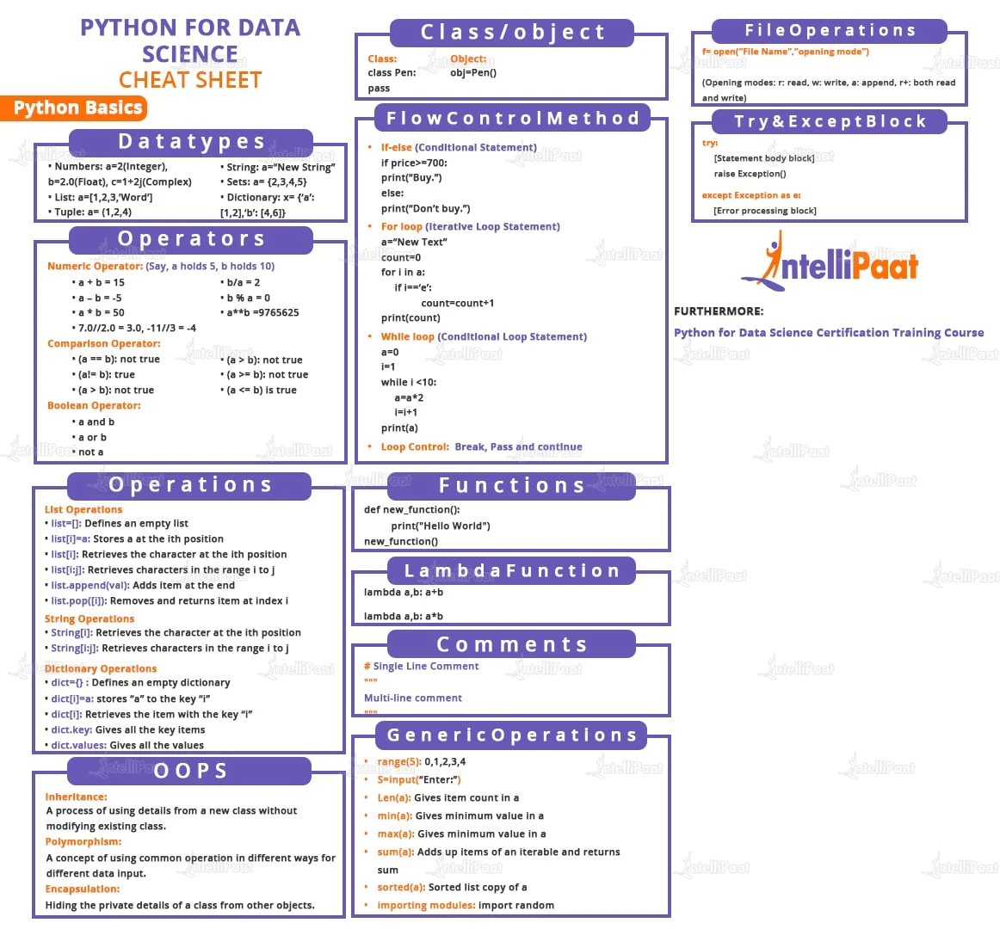
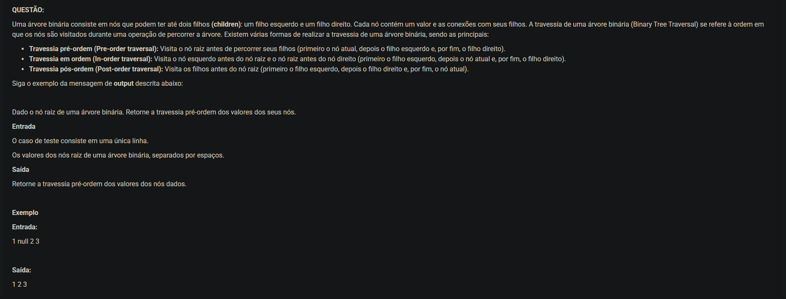
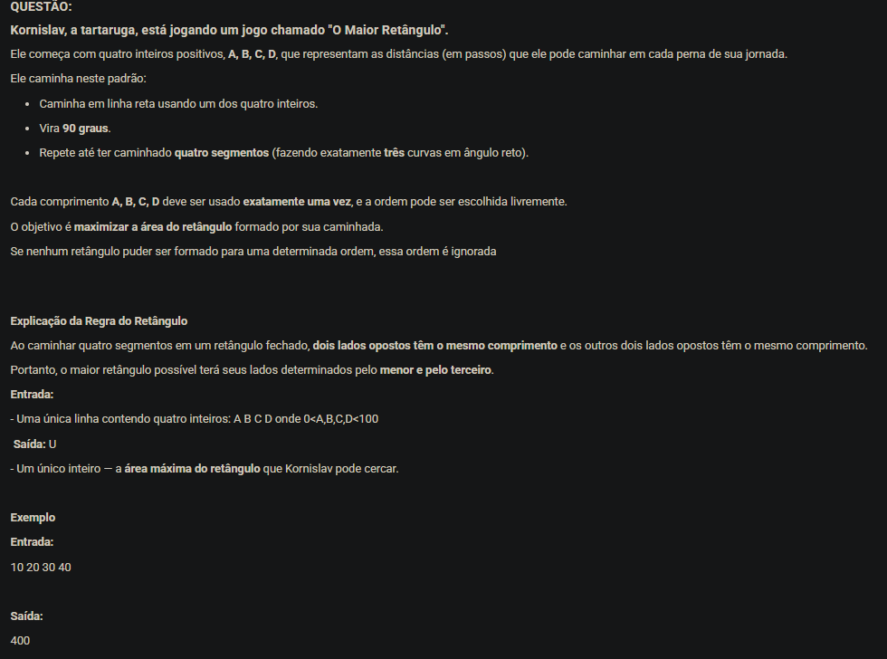
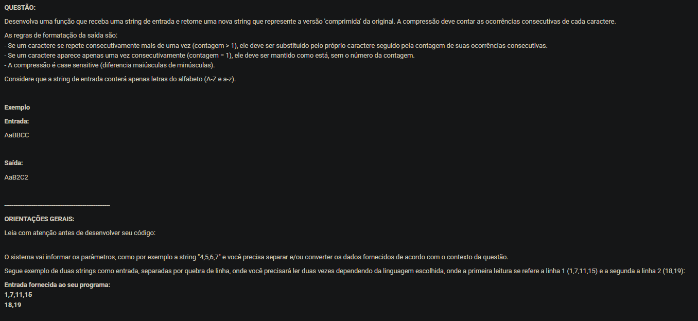
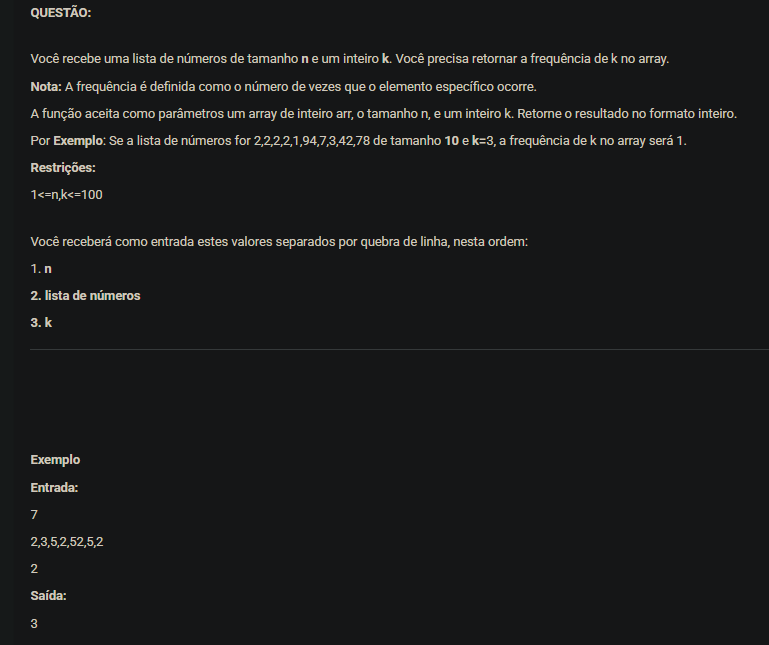

# Estudos em Python, Algoritmos FIAP e Automação de Chatbot WhatsApp


**Autor:** Renan Santa Rosa Xavier — RM566997

---

## Sobre o Repositório

Repositório dedicado à consolidação de estudos práticos em **Python**, incluindo guias interativos em **Jupyter Notebook**, resolução de exercícios avaliativos da FIAP, estruturas de dados (listas, dicionários, laços de repetição, funções) e scripts de **automação de atendimento via WhatsApp**.



---

## Estrutura de Conteúdo

### 1. Automação: Chatbot para WhatsApp ([`Python/Chat bot wpp/`](Python/Chat%20bot%20wpp))
Scripts em Python para envio automatizado e fluxo de mensagens no WhatsApp:
- [`whatsapp_bot_final.py`](Python/Chat%20bot%20wpp/whatsapp_bot_final.py) — Versão completa do bot de atendimento automatizado.
- [`whatsapp_bot.py`](Python/Chat%20bot%20wpp/whatsapp_bot.py) — Versão intermediária com controle de sessão e logs.
- [`whatsapp_bot_simples.py`](Python/Chat%20bot%20wpp/whatsapp_bot_simples.py) — Script enxuto para disparo rápido de mensagens.

### 2. Notebooks Interativos ([`Python/`](Python))
- [`guia_completo_python.ipynb`](Python/guia_completo_python.ipynb) — Caderno completo de referência e prática da linguagem Python.
- [`python_completo_Version2.ipynb`](Python/python_completo_Version2.ipynb) — Segunda versão expandida com exercícios práticos.

### 3. Exercícios FIAP & Estruturas de Dados ([`Python/Meus Exercicios e treino/`](Python/Meus%20Exercicios%20e%20treino))
- **Entregas Oficiais (RM566997):**
  - [`RM566997_EX01.py`](Python/Meus%20Exercicios%20e%20treino/RM566997_EX01.py)
  - [`RM566997_EX02.py`](Python/Meus%20Exercicios%20e%20treino/RM566997_EX02.py)
  - [`RM566997_EX03.py`](Python/Meus%20Exercicios%20e%20treino/RM566997_EX03.py)
  - [`RM566997_EX04.py`](Python/Meus%20Exercicios%20e%20treino/RM566997_EX04.py)
- **Treinamento de Estruturas:** Listas (`lista0.py` a `lista4.py`), Dicionários (`dicionario0.py`, `dicionario1.py`), Loops (`loop0.py`, `loop1.py`) e Funções (`funçoes0.py`).

---

## Registro Visual de Execução dos Exercícios

| Questão 1 | Questão 2 |
| :---: | :---: |
|  |  |

| Questão 3 | Questão 4 |
| :---: | :---: |
|  |  |

---

## Como Executar

```bash
# Executar qualquer script Python de exercício
python "Python/Meus Exercicios e treino/RM566997_EX01.py"

# Abrir os notebooks Jupyter
jupyter notebook "Python/guia_completo_python.ipynb"
```
